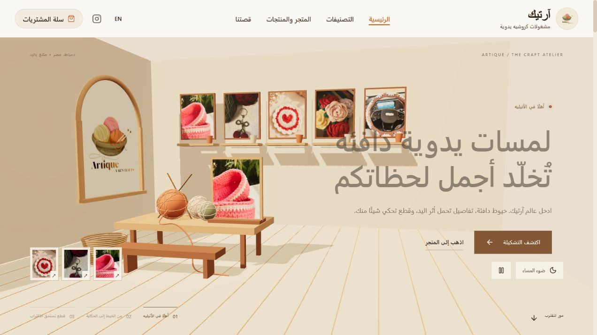
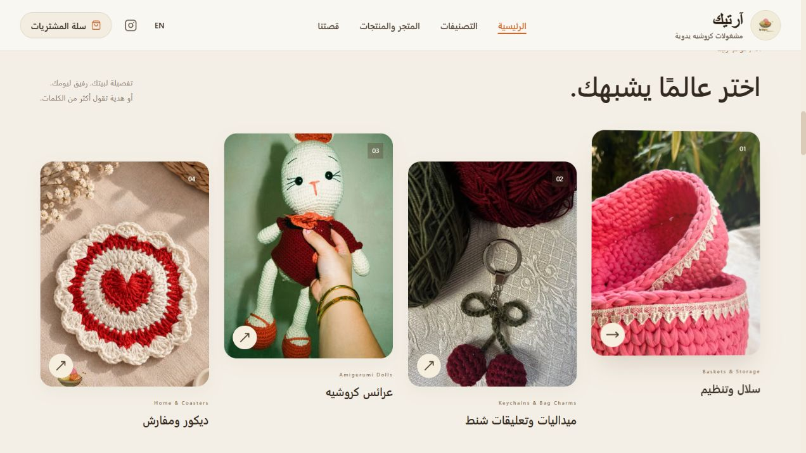
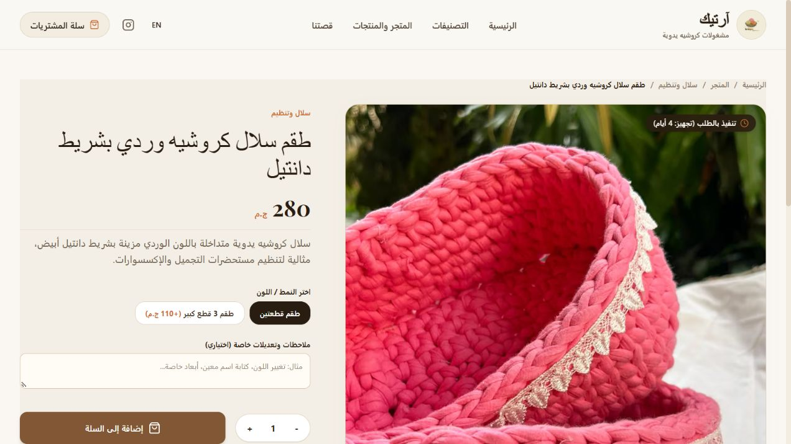
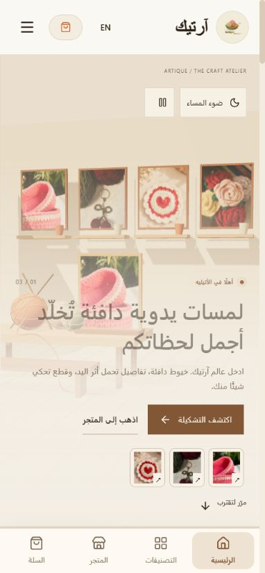
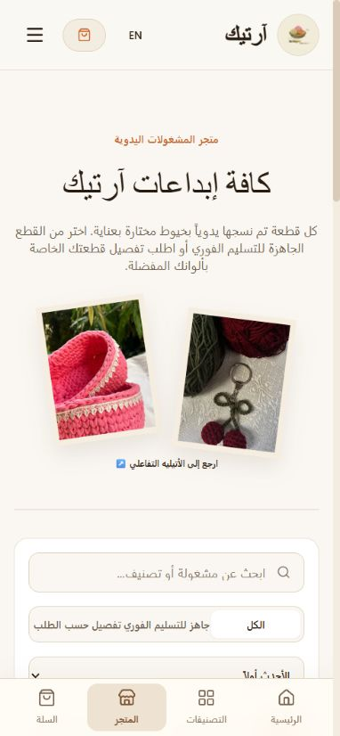

# Artique Store — 3D Commerce Showcase

[Live website](https://artique-store.vercel.app/) · [بالعربية](docs/README_AR.md)

A bilingual Arabic/English storefront for handmade crochet products, featuring an interactive Three.js atelier, responsive browsing, product variants, a cart, checkout, and an administration dashboard.



## About this repository

This is a sanitized, runnable portfolio snapshot maintained by [mn3m2001](https://github.com/mn3m2001). It is a separate repository with fresh history; it is not the live store's deployment source or original commit history. Development used AI-assisted tooling.

It includes application source, sample catalog data, automated tests, database schema, and public-facing screenshots. Production customer records, orders, payment proofs, credentials, environment files, database exports, and internal admin screenshots are excluded.

## Experience

- Interactive 3D atelier built with Three.js: product frames, camera movement, lighting controls, and reduced-motion support. The room is rendered in 3D; product photography is displayed on frames, rather than reconstructed as true 3D product models.
- Arabic RTL and English layouts; mobile navigation and responsive shopping views.
- Categories, filtering, product variants, quantity selection, quick view, and cart.
- Server-calculated checkout totals, stock checks, order access sessions, and payment-proof review flows.
- Product, order, shipping, settings, and review administration.
- Supabase server-side persistence and private media buckets in the production architecture.

## Stack

Next.js App Router · React · TypeScript · Three.js · Tailwind CSS · Supabase · Vitest · Vercel

## Run a local demo

Use Node.js 20.9+ and npm.

```sh
npm ci
npm run setup
npm run dev -- --hostname 127.0.0.1
```

Open http://localhost:3000. Generated local admin credentials are saved in the ignored `LOCAL-ACCESS.txt` file. There is no shared admin password. The setup creates `.env.local` only if it does not exist; do not copy an empty `.env.example` over it.

The demo uses an independent local JSON store, starts without real orders, and does not connect to the live Supabase project. Payment-transfer destinations are blank and disabled in the sample settings. Local order actions affect only your demo data. Credentials for your own Supabase project are optional and must remain in private environment variables.

```sh
npm test
npm run build
npm start
```

Run setup before starting a production build locally so signed sessions have a generated secret. A cloud deployment requires your own Supabase project and server-side configuration; never reuse another store's keys.

## Validation

Validated on 2026-10-15: 18 automated tests passed and the Next.js production build completed successfully. These checks validate this snapshot; they do not constitute a comprehensive security audit.

## Source map

| Area | Location |
| --- | --- |
| 3D scene and storytelling | `src/components/home/` |
| Storefront, checkout, and admin routes | `src/app/` |
| Store logic, local/cloud persistence, sessions | `src/lib/` |
| Private storage and database schema | `supabase/migrations/` |
| Isolated business-logic and session tests | `tests/` |

## Screenshots






Source is published for portfolio review. No software or branding license is granted by this repository; product imagery and branding remain subject to their owners' rights.
